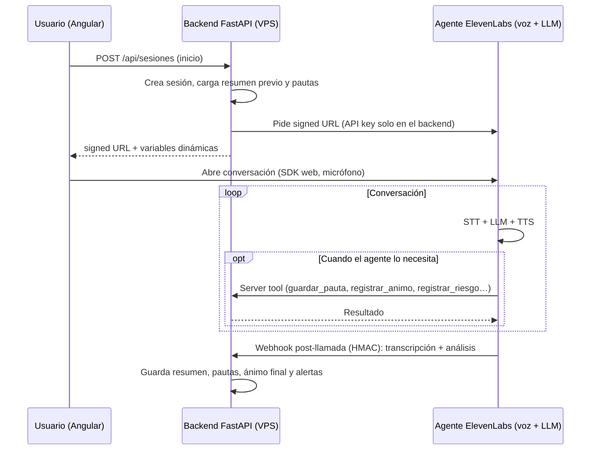

# ADR-001: Arquitectura de la conversación por voz (dónde vive el LLM)

- **Estado:** Aceptado (pendiente de validar con el spike)
- **Fecha:** 11 de octubre de 2026
- **Autor:** Juanjo
- **Relacionado con:** [Documento de visión y alcance](../vision-y-alcance.md)

## Contexto

Tera-pi mantiene una conversación por voz en manos libres. En cada turno hay cuatro piezas:

1. **STT** (voz a texto): entiende lo que dice el usuario.
2. **Gestión de turnos**: detecta cuándo ha terminado de hablar y permite interrumpir.
3. **LLM**: decide qué responder.
4. **TTS** (texto a voz): lo convierte en la voz del asistente.

La pregunta es **quién controla el LLM**. De ahí dependen la seguridad (protocolo de crisis), la memoria entre sesiones, el tratamiento de datos de salud, la latencia y la complejidad del proyecto.

**Entorno actual:**

- VPS Hostinger en **París (Francia)**, Ubuntu 24.04 con CloudPanel.
- ElevenLabs con plan **Starter**: según una fuente externa de septiembre de 2026, incluye unos 75 minutos de agente al mes y 6 conversaciones simultáneas. Hay que confirmarlo en el panel. No incluye residencia de datos en la UE ni *Zero Retention Mode*, que son de Enterprise.

## Opciones consideradas

### Opción A: todo en ElevenLabs (LLM integrado)

ElevenLabs hace STT, turnos, LLM (eligiendo un modelo en la configuración del agente) y TTS. Nuestro backend interviene en tres puntos:

- **Al empezar:** pasa contexto con variables dinámicas (`{{resumen_previo}}`, `{{pautas}}`…) y entrega al navegador una *signed URL*.
- **Durante la llamada:** el agente llama a nuestras **server tools** (webhooks) para guardar pautas, puntuaciones o avisos de riesgo.
- **Al terminar:** recibe la transcripción y el análisis por el **webhook post-llamada**, firmado con HMAC.

| A favor | En contra |
| --- | --- |
| La menor latencia posible | El backend no ve cada turno: el protocolo de crisis depende de que el modelo siga el prompt |
| Poco código; no hace falta API key de un proveedor de LLM | Dependencia del proveedor |
| Un solo proveedor y una sola factura | Probar el comportamiento automáticamente es más difícil |

### Opción B: LLM propio en nuestro backend (Custom LLM)

ElevenLabs hace la voz y en cada turno llama a un endpoint nuestro compatible con OpenAI. Cada turno pasa por nuestro código, así que permite una puerta de crisis determinista. El coste es más latencia, más código y un backend crítico en el camino de la voz.

### Opción C: pipeline completo propio

Descartada: hay que resolver audio en tiempo real, detección de fin de habla e interrupciones.

## Decisión

**Opción A: todo el proceso de voz y el LLM viven en ElevenLabs.** Nuestro backend FastAPI gestiona sesiones, memoria, server tools y webhooks, pero no está en el camino de cada turno.

Motivos: es la vía más simple para el MVP, no exige un segundo proveedor ni otra API key, tiene la menor latencia y permite aprender la plataforma a fondo.

**Condición para revisar esta decisión:** antes de abrir Tera-pi a usuarios reales fuera del círculo de pruebas, se escribirá un ADR nuevo para valorar el paso a la opción B (Custom LLM), que es la que da una puerta de crisis determinista. El backend se diseña desde ya para que ese paso sea pequeño.

### Cómo funciona una sesión

### Reglas de diseño

1. **La configuración del agente (prompt, modelo, herramientas, análisis) vive en git** como JSON en `elevenlabs/` y se despliega por la API de ElevenLabs. Nunca se edita a mano en el panel sin reflejarlo en el repositorio.
2. **El navegador nunca ve la API key de ElevenLabs:** agente privado y *signed URL* generada por el backend.
3. **El webhook post-llamada se valida siempre** con la firma `ElevenLabs-Signature` y su marca de tiempo.
4. **Se desactiva el envío y la grabación de audio** y se revisan los ajustes de retención del agente: no guardamos audio (minimización de datos).
5. **El protocolo de crisis en la opción A tiene tres capas**, todas imperfectas, que se combinan:
    - Reglas explícitas en el prompt: ante cualquier señal de riesgo, el agente deja de meditar, responde con el texto del protocolo y da los recursos (024, 112).
    - Herramienta obligatoria `registrar_riesgo`, que el agente debe llamar en ese caso; el backend la registra y alerta.
    - Criterio de evaluación "riesgo detectado" en el análisis post-llamada, para cazar casos que el agente no marcó durante la conversación.
6. **Batería de frases de riesgo:** se prueba contra el agente antes de cada cambio de prompt o de modelo.
7. **El backend no usa frameworks de orquestación de LLM** (LangChain o similares): no hay LLM propio que orquestar.

## Consecuencias

**Positivas**

- MVP más rápido y con menos piezas que mantener.
- La memoria, las herramientas y los datos ya están en nuestro backend, así que pasar a la opción B más adelante solo exige mover el LLM.

**Negativas y cómo las mitigamos**

- **La seguridad depende del modelo.** Se mitiga con las tres capas y la batería de pruebas, y queda como riesgo abierto hasta revisar la decisión antes de tener usuarios reales.
- **ElevenLabs y el proveedor del LLM tratan la conversación.** Se minimiza lo que se guarda en su lado. La residencia en la UE y el *Zero Retention Mode* requieren el plan Enterprise.
- **Dependencia del proveedor.** Se mitiga con la configuración en git y el backend desacoplado.

## Validación (spike)

- [x] Comprobar el datacenter de la VPS: París (Francia).
- [ ] Endurecer la VPS antes de exponer endpoints: usuario sin privilegios de root, SSH solo con clave, firewall y actualizaciones de seguridad.
- [ ] Crear un agente privado de prueba y guardar su configuración en `elevenlabs/agent.json`.
- [ ] Backend mínimo: endpoint que genera la *signed URL* y pasa variables dinámicas.
- [ ] Una server tool (`registrar_animo`) y el webhook post-llamada con validación HMAC.
- [ ] Probar 2–3 modelos del panel con las mismas frases en español: latencia, tono y si siguen el protocolo de crisis.
- [ ] Confirmar los minutos y la concurrencia que incluye el plan Starter.

## Referencias

- [ElevenLabs: Dynamic variables](https://elevenlabs.io/docs/eleven-agents/customization/personalization/dynamic-variables)
- [ElevenLabs: Server tools](https://elevenlabs.io/docs/eleven-agents/customization/tools/server-tools)
- [ElevenLabs: Post-call webhooks](https://elevenlabs.io/docs/agents-platform/workflows/post-call-webhooks)
- [ElevenLabs: Integrate your own model (Custom LLM)](https://elevenlabs.io/docs/eleven-agents/customization/llm/custom-llm)
- [ElevenLabs: Data residency](https://elevenlabs.io/docs/de/overview/administration/data-residency)
