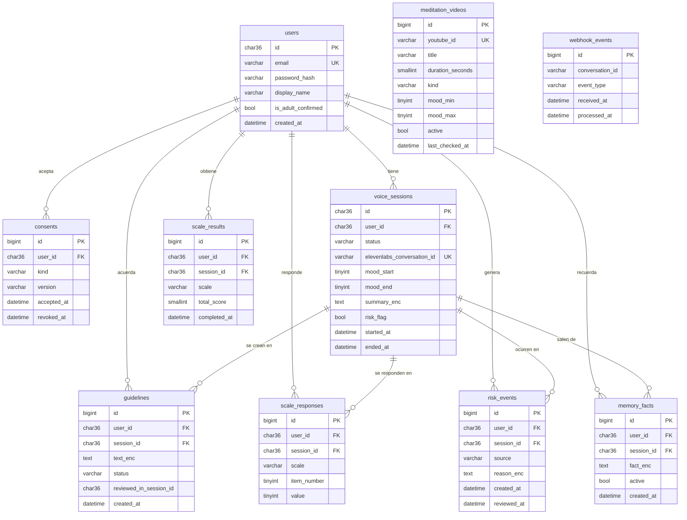

# ADR-002: Base de datos y modelo de datos

- **Estado:** Propuesto
- **Fecha:** 12 de octubre de 2026
- **Autor:** Juanjo
- **Relacionado con:** [Visión y alcance](../vision-y-alcance.md) · [ADR-001](ADR-001-arquitectura-conversacion-voz.md) · [Infra 01](../infra/01-subdominios-y-sites.md)

## Contexto

Según el [ADR-001](ADR-001-arquitectura-conversacion-voz.md), la conversación y el LLM viven en ElevenLabs, y nuestro backend guarda todo lo que el agente necesita **recordar** entre sesiones y todo lo que la app necesita **medir**:

- usuarios y consentimientos;
- sesiones de voz, con el ánimo al inicio y al final;
- pautas acordadas y si se cumplieron;
- respuestas a las escalas (PHQ-9, GAD-7, PSS-10);
- eventos de riesgo;
- memoria a largo plazo ("cosas a recordar");
- catálogo de vídeos de meditación de YouTube.

Son datos de salud (RGPD, art. 9), claramente relacionales (usuario → sesiones → pautas y puntuaciones) y de poco volumen.

**Entorno disponible:** CloudPanel en la VPS ya incluye y gestiona **Percona Server 8.4** (compatible al 100 % con MySQL 8.4 LTS), con creación de bases de datos y usuarios, phpMyAdmin y copias de seguridad. Ya existe la base de datos `terapi` con el usuario `terapiapp`, que solo tiene permisos sobre ella.

## Opciones consideradas

| Opción | A favor | En contra |
| --- | --- | --- |
| **MySQL 8.4 de CloudPanel** | Incluida y gestionada (copias, usuarios, phpMyAdmin); gratis; madura | JSON y tipos algo menos ricos que PostgreSQL |
| PostgreSQL instalado aparte | Tipos más ricos (`jsonb`, `uuid`), muy habitual en Python | CloudPanel no lo gestiona: instalación, copias y actualizaciones por nuestra cuenta |
| MongoDB u otra NoSQL | Esquema flexible | Los datos son relacionales; otra pieza que operar |
| Base de datos vectorial | Búsqueda semántica | No hay búsqueda semántica: la memoria es un resumen que se pasa como variable al agente |
| Redis | Caché y colas | No hay caché ni colas que lo justifiquen en el MVP |

## Decisión

**Una sola base de datos relacional: MySQL 8.4 (Percona) de CloudPanel**, con la base de datos `terapi` y el usuario `terapiapp`. Solo se accede desde `localhost`.

**Acceso desde Python:**

- **SQLAlchemy 2.0** como ORM, en modo **síncrono** con el driver **PyMySQL** (más `cryptography`, que necesita para la autenticación `caching_sha2_password` de MySQL 8.4). Con este volumen, los endpoints síncronos de FastAPI (que se ejecutan en un *threadpool*) son más que suficientes y más fáciles de depurar que el modo asíncrono.
- **Alembic** para las migraciones: cada cambio de esquema es un fichero versionado en git.
- En desarrollo local, el mismo motor en Docker (`docker compose`), para que lo que funciona en local funcione igual en producción.

## Modelo de datos

### Tablas

| Tabla | Para qué | Notas |
| --- | --- | --- |
| `users` | Cuenta del usuario | El login se decidirá en un ADR propio. `password_hash` con Argon2 |
| `consents` | Qué aceptó y cuándo: términos, privacidad, **tratamiento de datos de salud** | Se guarda la versión del texto aceptado. Revocar no borra la fila, la marca |
| `voice_sessions` | Una fila por sesión de voz | Su `id` (UUID aleatorio) se pasa al agente como variable dinámica `session_id` y vincula server tools y webhook con la sesión |
| `guidelines` | Pautas acordadas | `status`: `pending`, `done`, `partial`, `dropped`. `reviewed_in_session_id` indica en qué sesión se revisó |
| `scale_responses` | Respuesta a cada ítem de una escala | Única por (`session_id`, `scale`, `item_number`). Permite detectar el ítem 9 del PHQ-9 |
| `scale_results` | Puntuación total de una escala completada | Dato derivado, guardado para mostrar tendencias sin recalcular |
| `risk_events` | Cada activación del protocolo de crisis | `source`: `tool` (durante la llamada), `post_call` (análisis), `phq9_item9` |
| `memory_facts` | Memoria a largo plazo ("trabaja de noche", "tiene un perro") | Se pasan al agente las últimas N activas. El usuario puede verlas y borrarlas |
| `meditation_videos` | Lista revisada de vídeos de YouTube | Se eligen por `kind` y por rango de ánimo |
| `webhook_events` | Registro de webhooks recibidos | Sirve para **idempotencia**: si ElevenLabs reenvía un webhook, no se procesa dos veces. No guarda la transcripción |

### Cómo se pasa la memoria al agente

Al empezar una sesión, el backend construye las variables dinámicas a partir de estas tablas:

| Variable | Origen |
| --- | --- |
| `session_id` | `voice_sessions.id` de la sesión recién creada |
| `nombre` | `users.display_name` |
| `resumen_previo` | `summary_enc` de las últimas 1–3 sesiones completadas |
| `pautas_pendientes` | `guidelines` con `status = pending` |
| `cosas_a_recordar` | Últimos N `memory_facts` activos |
| `tendencia_animo` | `mood_start` y `mood_end` de las últimas sesiones |

## Reglas de diseño

1. **Minimización de datos: no se guarda la transcripción completa** ni el audio. Del webhook post-llamada solo se guardan el resumen, los datos extraídos y los eventos.
2. **Cifrado a nivel de aplicación** de los campos de texto libre sensibles (los que terminan en `_enc`): resumen, pautas, motivo de riesgo y memoria. Se usa Fernet (biblioteca `cryptography`) con una clave en la variable de entorno `DATA_ENCRYPTION_KEY`, que nunca va a git.
    - **Qué protege:** copias de seguridad, volcados de la base de datos o un acceso indebido a phpMyAdmin.
    - **Qué no protege:** un atacante con control total del servidor, que podría leer también la clave. Es una capa más, no la única.
    - Para rotar la clave en el futuro se usará `MultiFernet` (clave nueva para cifrar, claves antiguas para descifrar).
3. **Identificadores:** UUID aleatorio guardado como texto de 36 caracteres (`VARCHAR(36)`) para `users` y `voice_sessions`, porque viajan fuera del backend (al agente, al frontend) y no deben ser adivinables. Las demás tablas usan `BIGINT AUTO_INCREMENT`.
4. **Nunca confiar en un `user_id` que llegue de fuera.** Las server tools reciben el `session_id`; el backend busca la sesión y de ella saca el usuario. Las variables dinámicas las envía el navegador, así que un usuario podría manipularlas, pero solo afectaría a su propia sesión, y adivinar el UUID de otra sesión es inviable.
5. **Borrado real (derecho de supresión):** al borrar una cuenta se borran en cascada todas sus filas. No hay borrado lógico para los datos de salud.
6. **Fechas en UTC** en la base de datos; la conversión a la hora local se hace en el frontend.
7. **Charset `utf8mb4`** y colación `utf8mb4_0900_ai_ci` (la de MySQL 8.4 por defecto), para acentos y emojis.
8. **Copias de seguridad automáticas** con las copias remotas de CloudPanel, cifradas y fuera de la VPS. Se configurarán antes de tener datos reales.

## Consecuencias

**Positivas**

- Cero coste e infraestructura adicional: todo está ya en la VPS y CloudPanel lo gestiona.
- El esquema vive en git (modelos SQLAlchemy y migraciones Alembic).
- Los datos más sensibles no son legibles en un volcado de la base de datos.

**Negativas y mitigaciones**

- **Los campos cifrados no se pueden buscar ni filtrar** con SQL. Se acepta: nunca se busca por el contenido de un resumen o una pauta.
- **Perder `DATA_ENCRYPTION_KEY` equivale a perder esos datos.** La clave se guarda también en el gestor de contraseñas, fuera del servidor.
- **MySQL es menos expresivo que PostgreSQL.** Para este modelo no se necesita nada que MySQL no tenga.

## Pendiente

- [ ] ADR sobre autenticación de usuarios (sesión con cookie o JWT).
- [ ] Política de retención: cuánto tiempo se guardan las sesiones de usuarios inactivos.
- [ ] Configurar las copias remotas de CloudPanel antes de tener datos reales.
