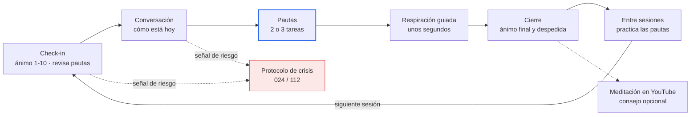

# Tera-pi — Documento de visión y alcance (v0.1)

11 de octubre de 2026 · Juanjo

## Resumen

Tera-pi es un asistente de bienestar emocional por voz, en manos libres, para personas que atraviesan una etapa de estrés o ánimo bajo. En cada sesión la persona habla con el asistente, se lleva dos o tres pautas concretas para practicar hasta la siguiente y termina con un breve ejercicio de respiración guiada. Al despedirse, el asistente puede sugerir una meditación guiada en YouTube como opción. El asistente recuerda las sesiones anteriores, revisa cómo fueron las pautas y mide la evolución con cuestionarios breves y validados. Cuando la persona está receptiva, introduce ideas del estoicismo como herramienta práctica.

Tera-pi **no es un psicólogo ni diagnostica**: acompaña, mide la evolución y deriva a un profesional cuando hace falta.

## Problema y usuario principal

El usuario principal es un adulto que en este momento se siente decaído o inestable: estrés sostenido, ansiedad o síntomas depresivos de **leves a moderados**. No sabe cómo calmar la mente por su cuenta y necesita algo accesible en el momento, sin listas de espera ni coste de una consulta.

**Qué debería conseguir tras cada sesión:**

- Sentirse más tranquilo y animado que al empezar.
- Llevarse unas pautas claras y realistas para los próximos días.
- Notar, sesión a sesión, que su estado mejora y poder verlo.

**Fuera del público objetivo (se le deriva, no se le atiende):**

- Menores de 18 años.
- Personas con síntomas graves, ideas de hacerse daño o en crisis. El asistente activa el protocolo de crisis y da recursos (en España, el 024 y el 112).
- Personas con un trastorno diagnosticado que buscan sustituir su tratamiento.

## Propuesta de valor y posicionamiento

Tera-pi se presenta como **asistente de bienestar emocional y meditación**, nunca como psicólogo ni terapeuta. En España "psicólogo" es una profesión regulada, y una app que diagnostica pasa a ser un producto sanitario bajo el Reglamento (UE) 2017/745, con certificación CE obligatoria.

Lo que lo diferencia:

- **Voz en manos libres**: hablar es más natural que escribir cuando uno está mal.
- **Continuidad**: recuerda qué se habló y qué pautas se acordaron.
- **Progreso visible**: cuestionarios breves que muestran la evolución.
- **Estoicismo dosificado**: ideas prácticas (distinguir lo que depende de uno, por ejemplo) solo cuando la persona está estable y receptiva, nunca en un momento de malestar agudo.

## Ciclo de una sesión

Cada sesión sigue cinco pasos dentro de una sola conversación por voz, y las pautas unen una sesión con la siguiente. Tras acordar las pautas, el asistente guía una respiración de unos segundos y, justo después, hace el cierre. En el cierre mide el ánimo final y, como consejo opcional, sugiere una meditación guiada de YouTube de una lista revisada, elegida según el ánimo del check-in. Si en el check-in o en la conversación aparece una señal de riesgo, se para todo y se activa el protocolo de crisis.

## Seguimiento del progreso (en lugar de diagnóstico)

Tera-pi **mide la evolución, no diagnostica**. Se usan escalas autoaplicadas y validadas, que el asistente lee en voz alta y la persona responde hablando. Las puntuaciones sirven para ver tendencias y para decidir cuándo derivar, nunca para poner una etiqueta clínica.

| Instrumento | Qué mide | Ítems / rango | Frecuencia propuesta |
| --- | --- | --- | --- |
| Check-in de ánimo | Ánimo y estrés del momento | 2 preguntas, 1–10 | Inicio y final de cada sesión |
| PHQ-9 | Síntomas depresivos (últimas 2 semanas) | 9 ítems, 0–27 | Al empezar y cada 2 semanas |
| GAD-7 | Ansiedad (últimas 2 semanas) | 7 ítems, 0–21 | Al empezar y cada 2 semanas |
| PSS-10 | Estrés percibido (último mes) | 10 ítems, 0–40 | Al empezar y cada 4 semanas |

**Reglas de seguridad ligadas a las escalas:**

- Cualquier respuesta distinta de 0 en el ítem 9 del PHQ-9 (ideas de hacerse daño) activa el protocolo de crisis al momento.
- PHQ-9 ≥ 20 o GAD-7 ≥ 15 (rango grave): el asistente recomienda con claridad acudir a un profesional y lo recuerda en las sesiones siguientes.
- Empeoramiento sostenido en dos mediciones seguidas: misma recomendación.

El check-in de inicio y final de sesión da además una señal inmediata de si la sesión ayudó.

## Alcance del MVP

El MVP es una web responsive en español donde un usuario completa el ciclo entero de sesión por voz y ve su evolución.

1. **Registro y consentimiento**: cuenta con email y contraseña, verificación de mayoría de edad, aviso de que no sustituye a un profesional y consentimiento explícito para tratar datos de salud.
2. **Valoración inicial**: PHQ-9, GAD-7 y PSS-10 por voz como línea base.
3. **Sesión por voz en manos libres** con el agente conversacional de ElevenLabs: check-in, conversación, pautas, respiración guiada de unos segundos y cierre. En el cierre puede sugerir, como consejo opcional, una meditación guiada de YouTube de una lista revisada.
4. **Pautas**: 2 o 3 tareas acordadas por sesión, guardadas y revisadas en la siguiente.
5. **Memoria entre sesiones**: un resumen de cada sesión que el asistente usa como contexto en la siguiente.
6. **Protocolo de crisis**: detección durante la conversación y en el ítem 9 del PHQ-9, respuesta fija y revisada, y recursos (024, 112).
7. **Panel de progreso**: evolución de las escalas y del ánimo, y lista de pautas.
8. **Derechos sobre los datos**: descargar y borrar la cuenta y todo su historial.

## Fuera de alcance (no-objetivos)

Estas cosas no entran en el MVP. Algunas pueden llegar después; el diagnóstico, nunca.

- Diagnóstico o tratamiento de trastornos mentales.
- Apps móviles nativas (la web responsive cubre el móvil).
- Pagos y suscripciones.
- Panel para psicólogos o terapeutas.
- Otros idiomas aparte del español.
- Notificaciones push y recordatorios.
- Integración con wearables (sueño, pulso).
- Funciones sociales o de comunidad.

## Métricas de éxito

Los objetivos son propuestas iniciales para validar con los primeros usuarios, no compromisos.

| Métrica | Cómo se mide | Objetivo inicial |
| --- | --- | --- |
| Seguridad: detección de crisis | Batería de frases de prueba con riesgo, en cada versión | 100 % detectadas antes de publicar |
| Alivio en la sesión | Ánimo al final menos ánimo al inicio (1–10) | Positivo en la mayoría de sesiones |
| Retención | Usuarios que hacen una 2.ª sesión en 7 días | Por definir con datos reales |
| Cumplimiento de pautas | Pautas marcadas como hechas en la sesión siguiente | Por definir con datos reales |
| Evolución | Tendencia de PHQ-9, GAD-7 y PSS-10 frente a la línea base | Se observa, no se promete |
| Latencia de voz | Tiempo entre fin de habla del usuario y respuesta | Conversación fluida, sin pausas incómodas |

## Riesgos

El riesgo número uno es fallar a alguien en crisis; por eso la seguridad se diseña antes que cualquier otra función.

| Riesgo | Tipo | Mitigación |
| --- | --- | --- |
| No detectar a una persona en crisis | Seguridad | Doble capa (prompt del agente + clasificador en backend), respuesta fija revisada, pruebas obligatorias antes de cada despliegue |
| El asistente da un consejo dañino o "diagnostica" | Seguridad / legal | Prompt con límites explícitos, revisión de conversaciones de prueba, asesoría de un psicólogo colegiado |
| Presentarse como psicólogo o producto sanitario | Legal | Lenguaje de "bienestar" en toda la app y textos legales revisados |
| Fuga de datos de salud | RGPD (art. 9) | Cifrado en tránsito y en reposo, mínimo de datos, sin guardar audio por defecto, borrado a petición |
| Datos procesados por terceros fuera de la UE (ElevenLabs, proveedor del LLM) | RGPD | Revisar contratos de encargado del tratamiento, retención de datos y región de servidores |
| Meditación en YouTube: anuncios que la interrumpen, vídeos retirados o sin permiso de inserción, recomendaciones al terminar | Producto | Lista curada de vídeos en la base de datos, inserción con youtube-nocookie, comprobación periódica de que siguen disponibles; a futuro, meditaciones propias |
| Dependencia emocional del asistente | Ético | El asistente anima a apoyarse también en personas reales y en profesionales |
| Latencia o cortes de voz | Técnico | Medir desde el primer prototipo; plan B en texto |
| Coste por minuto de voz y LLM | Negocio | Medir coste por sesión desde el principio y limitar la duración |

## Preguntas abiertas y próximos pasos

**Preguntas abiertas**

- ¿Qué LLM gobierna la conversación: el integrado en el agente de ElevenLabs o uno propio llamado desde el backend?
- ¿Qué guarda ElevenLabs (audio, transcripciones), cuánto tiempo y en qué región?
- ¿Licencias de las escalas para uso comercial? (PHQ-9 y GAD-7 son de uso libre; PSS-10 hay que confirmarlo.)
- ¿Habrá un psicólogo colegiado que asesore y revise el protocolo de crisis?
- ¿Es un proyecto de aprendizaje o se publicará para usuarios reales? Cambia el nivel de exigencia legal.

**Próximos pasos**

- [ ] Revisar y cerrar este documento (v1.0).
- [ ] Crear el repositorio git con `backend/`, `frontend/` y `docs/`, y guardar ahí este documento.
- [ ] ADR-001: arquitectura de la conversación por voz (dónde vive el LLM).
- [ ] ADR-002: bases de datos y modelo de datos.
- [ ] Diseñar el protocolo de crisis y su batería de pruebas.
