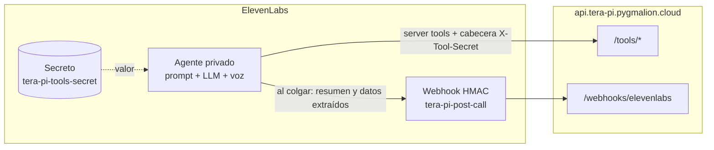

# Agente de ElevenLabs

Configuración del agente de voz de Tera-pi. Según el [ADR-001](../docs/adr/ADR-001-arquitectura-conversacion-voz.md), regla 1, **vive en git y se despliega con un script**. No se edita a mano en el panel: si cambias algo allí, el siguiente despliegue lo sobrescribe.

| Fichero | Qué contiene |
| --- | --- |
| `prompt.md` | El prompt del sistema: identidad, protocolo de crisis, ciclo de sesión, cuestionarios y herramientas |
| `agent.json` | Voz, idioma, LLM, turnos, privacidad, límites, datos a extraer y criterios de evaluación |
| `tools.json` | Las cuatro server tools que llaman al backend |
| `deploy_agent.py` | Crea o actualiza en ElevenLabs el secreto, el webhook, las tools y el agente |
| `state.json` | Los ids de lo creado (lo genera el script; no contiene secretos y se sube a git) |

## Cómo encajan las piezas



- **El `session_id` nunca lo decide el LLM.** En `tools.json`, ese parámetro sale de la variable dinámica `{{session_id}}` que el backend entrega al empezar. El modelo solo rellena el ánimo, la pauta, la respuesta o el motivo.
- **El secreto de las tools vive en ElevenLabs como secreto del workspace.** En la configuración de las tools solo aparece su id. El valor es el mismo que `TOOLS_SHARED_SECRET` en el `.env` de la VPS.
- **El webhook solo envía el resumen y el análisis** (`events: ["transcript"]` con `exclude_transcript: true`). Ni audio ni transcripción: minimización de datos.
- **Ojo: las variables dinámicas las envía el navegador.** El `session_id` lo genera el backend, pero viaja por el cliente hasta ElevenLabs, así que alguien con acceso podría cambiarlo. Hoy lo protege que es un UUID imposible de adivinar. Cuando haya autenticación real, conviene que el backend compruebe que la sesión pertenece al usuario de la conversación.
- **El agente es privado** (`enable_auth`): solo se puede abrir con una *signed URL* que genera el backend.
- **Grabación de voz desactivada**, conversaciones guardadas 30 días en ElevenLabs para poder revisarlas durante el spike, y límites de 2 llamadas simultáneas y 20 al día para proteger los minutos del plan Starter.

## Antes de la primera vez: dos API keys

En ElevenLabs → **Developers → API keys**, crea dos claves con permisos distintos. Es el principio de **mínimo privilegio**: si alguien roba la clave del servidor, no puede reconfigurar tu agente.

| Clave | Dónde se usa | Permisos |
| --- | --- | --- |
| `tera-pi-admin` | Solo en tu PC, para ejecutar `deploy_agent.py` | Escritura en **ElevenAgents** y en **Webhooks** del workspace |
| `tera-pi-backend` | En el `.env` de la VPS (`ELEVENLABS_API_KEY`) | Solo **ElevenAgents**, lo mínimo que permita el panel. El backend solo pide *signed URLs* |

Guarda las dos en tu gestor de contraseñas. Si al probar `POST /api/sesiones` el backend responde 502 y en el log aparece un 401 o 403 de ElevenLabs, sube un nivel los permisos de la clave del backend.

## Desplegar el agente

Necesitas el **mismo** `TOOLS_SHARED_SECRET` que pusiste en el `.env` de la VPS (paso 4 de [Infra 03](../docs/infra/03-despliegue-backend.md)).

```powershell
cd C:\Users\juanj\OneDrive\Development\tera-pi\backend

# 1. Ver qué se va a enviar, sin tocar nada (no pide claves)
uv run python ..\elevenlabs\deploy_agent.py --dry-run

# 2. Desplegar de verdad. Te pedirá la API key de administración y TOOLS_SHARED_SECRET
#    sin mostrarlos en pantalla, así no quedan en el historial de PowerShell.
uv run python ..\elevenlabs\deploy_agent.py
```

La primera vez, el script muestra al final:

```
Valores para el .env de la VPS:
  ELEVENLABS_AGENT_ID=agent_...
  ELEVENLABS_WEBHOOK_SECRET=wsec_...

  ATENCIÓN: ElevenLabs no volverá a mostrar este secreto. ...
```

Copia el `ELEVENLABS_WEBHOOK_SECRET` **en ese momento** a tu gestor de contraseñas. Si lo pierdes, borra el webhook en el panel (**Developers → Webhooks**), quita `webhook_id` de `state.json` y vuelve a ejecutar el script: creará uno nuevo con un secreto nuevo.

Después, sube `state.json` a git.

## Cambiar algo

1. Edita `prompt.md`, `agent.json` o `tools.json`.
2. Vuelve a ejecutar `uv run python ..\elevenlabs\deploy_agent.py`. Actualiza lo que existe y no crea duplicados.
3. Si has cambiado el prompt o el modelo, pasa la batería de frases de riesgo (ADR-001, regla 6) antes de darlo por bueno.
4. Haz commit de los cambios: el historial de git es el historial del agente.

**Rotar el secreto de las tools:** genera uno nuevo, cámbialo en el `.env` de la VPS y ejecuta el script con `--rotar-secreto-tools`. Reinicia el servicio en la VPS justo después: entre los dos pasos, las tools fallarán.

## Probar modelos (spike)

El ADR-001 pide comparar 2 o 3 modelos con las mismas frases. El punto de partida es `gemini-3.1-pro-preview`, el que usabas en tus prototipos "Psicóloga Lydia" y "Psicólogo Emilio". Para probar otro, cambia `conversation_config.agent.prompt.llm` en `agent.json`, despliega y repite la batería. Candidatos razonables por latencia: `gemini-3-flash-preview`, `claude-haiku-4-5` y `gpt-5-mini`. Apunta para cada uno:

- **Latencia percibida:** ¿hay silencios incómodos?
- **Tono:** ¿suena cálido y natural en español de España?
- **Protocolo de crisis:** ¿llama a `registrar-riesgo` y da el 024 y el 112 en todas las frases de riesgo?
- **Herramientas:** ¿llama a `registrar-animo` dos veces y a `guardar-pauta` una vez por pauta?

La voz (`SDVJaMLoJa7wc3s2sn7d`, la de "Lydia") y el modelo de voz (`eleven_v4_turbo`) se cambian igual en el bloque `tts`. Si `eleven_v4_turbo` no suena bien en español, prueba `eleven_turbo_v2_5`, el de tus prototipos.

## Pendiente de revisar antes de usuarios reales

- [ ] Comparar el texto de las preguntas del PHQ-9 y el GAD-7 de `prompt.md` con la versión española validada oficial (están redactadas para leerse en voz alta).
- [ ] Confirmar la licencia del PSS-10. Hasta entonces el agente no lo propone; el backend sí sabe puntuarlo.
- [ ] Que un psicólogo colegiado revise el protocolo de crisis y los recursos.
- [ ] Reducir `retention_days` cuando ya no haga falta revisar las conversaciones en el panel.
